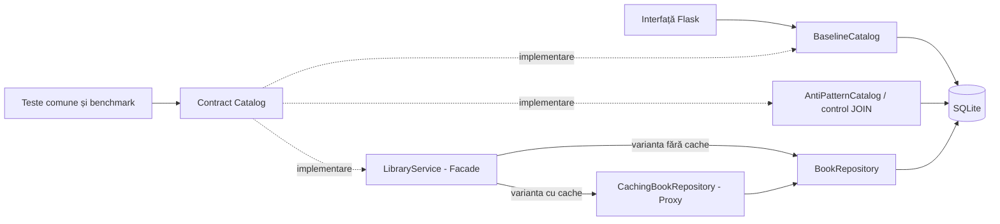
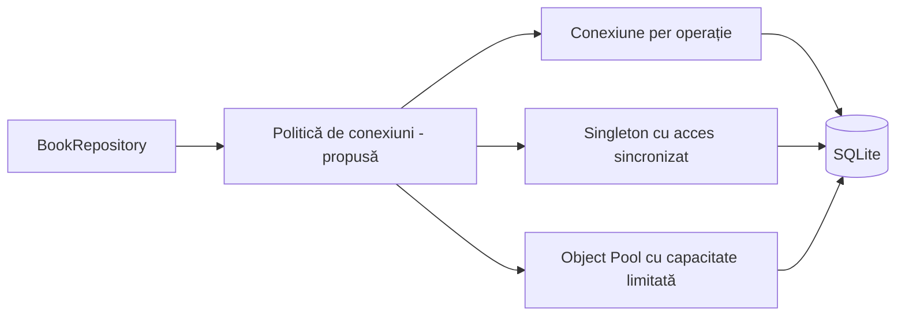
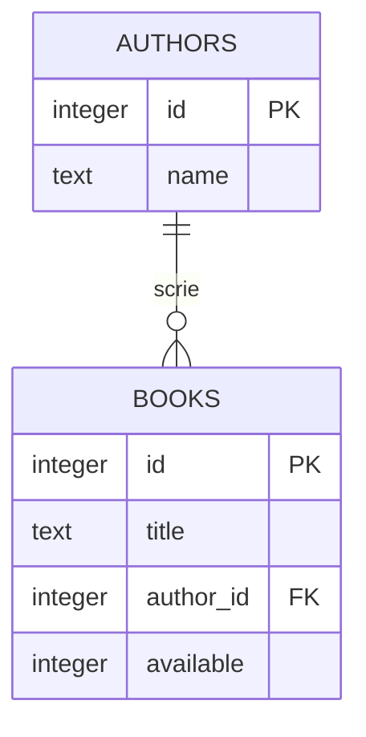

# M1 — Proiectare și fundamentare: material pentru prezentare

Material pregătit pe baza implementării existente la commit-ul `552da88`.
Poți folosi structura de mai jos pentru un PPT de aproximativ 10–12 minute,
plus o demonstrație scurtă. La fiecare slide, „Pe slide” este textul de afișat,
iar „De spus” este explicația orală, care nu trebuie copiată integral în PPT.

**Perspectiva prezentării:** includem ambele perspective, în paralel:
**întregul studiu** și **stadiul actual la M1**. Pentru fiecare temă explicăm
ce vrem să evaluăm până la final și ce există deja. Rezultatele preliminare
nu înlocuiesc proiectarea, iar activitățile planificate nu sunt prezentate ca realizate.

## Imagine de ansamblu — proiectul complet și stadiul actual

Acest tabel este reperul pentru construirea slide-urilor. Poți folosi aceleași
două coloane în PPT, fără să adaugi un slide separat pentru tabelul întreg.

| Temă | Întregul studiu | Stadiul actual la M1 |
|---|---|---|
| Obiective | Performanță, resurse, scalabilitate, mentenabilitate și efort de extindere | Pilot de execuție și corectitudine; efortul nu este încă măsurat |
| Pattern-uri | Repository, Facade, Proxy cu cache, Singleton și Object Pool | Primele trei implementate; ultimele două planificate |
| Stiluri și anti-pattern-uri | Monolit vs straturi; N+1 și responsabilități amestecate | Variantele comparative există; impactul asupra mentenabilității rămâne de evaluat |
| Metodologie | Volume până la 50.000, concurență, scenarii cache variate și aceeași extensie în variante | 5 variante, 100/1.000/10.000 de cărți, 3 scenarii, 10 repetări, secvențial |
| Metrici | Timp, SQL, alocări Python, rezultate concurente, metrici statice și efort | Timp, SQL, alocări Python, sumarizări și teste de corectitudine |
| Arhitectură | Contract comun, variante substituibile și politici injectabile de conexiuni | Contractul și variantele există; politicile de conexiuni sunt proiectate |
| Aplicație | Același catalog ca suport pentru toate experimentele; căutare după autor pentru experimentul de extindere | UI pe baseline: listare, căutare după titlu, detalii, împrumut și returnare |
| Dovezi | Comparații de execuție și de cost al schimbării, cu limite explicite | 60 de teste trecute și 450 de probe pilot; nu avem încă rezultate de efort/concurență |

## Este suficient ce avem pentru etapa 1?

**Da: pentru cele șase cerințe comunicate, avem conținut și o implementare
suficiente pentru o prezentare consistentă.** Avem inclusiv rezultate pilot,
deși cerința menționează doar stadiul implementării și o eventuală demonstrație.
Nu avem încă un studiu final al tuturor pattern-urilor și nici nu trebuie să
pretindem acest lucru la această etapă.

| Cerință primită | Ce prezentăm | Acoperire |
|---|---|---|
| Problema, obiectivele și aplicația | Catalogul și întrebarea despre beneficiile/costurile pattern-urilor | Slide-urile 1–3 |
| Șabloane/stiluri, motivație și avantaje anticipate | Toate cele 5 pattern-uri alese și comparația arhitecturii monolitice cu separarea pe straturi | Slide 4 |
| Ipoteze, metrici și metodologie | Planul complet de evaluare: execuție, resurse, concurență și costul schimbării | Slide-urile 5–6 |
| Arhitectură, diagrame și variante | Variantele existente și extinderea propusă pentru conexiuni | Slide-urile 7–8 |
| Stadiul implementării și demonstrație | Cod integrat, teste, rezultate pilot și interfață funcțională | Slide-urile 9–10 |
| Echipă, roluri, sprinturi și plan până la M2 | Contribuții realizate și plan propus pentru următorul milestone | Slide-urile 11–12 |

Înainte de PPT trebuie completate numele membrilor, datele reale ale sprinturilor,
data M2 și durata impusă prezentării, dacă există. Nu sunt cunoscute din repo.
Planul M2 de aici este o propunere: cerințele oficiale M2 nu au fost furnizate.
Documentele generale de stare au rămas parțial în urmă; pentru stadiul prezentat
aici am folosit codul, testele și rezultatele integrate, nu etichetele vechi
„planificat” din acele documente.

## Slide 1 — Titlul și ideea proiectului

**Pe slide**

**Impactul pattern-urilor de proiectare asupra accesului la date**

Studiu comparativ pe un catalog de bibliotecă, în Python și SQLite.

- Aceleași funcționalități, organizări diferite ale codului.
- Evaluăm performanța, scalabilitatea, resursele și costul modificărilor.
- Echipa: [cele 4 nume].

**De spus**

„Proiectul nostru urmărește să vadă ce aduc concret pattern-urile într-o
aplicație mică. Nu pornim de la ideea că varianta cu pattern-uri este mereu mai
bună. Comparăm beneficii, costuri și condițiile în care apar.”

## Slide 2 — Problema și obiectivele

**Pe slide**

- Accesul la date poate produce interogări inutile și citiri repetate.
- Amestecarea responsabilităților poate îngreuna testarea și modificările.
- Separarea codului introduce la rândul ei clase și niveluri suplimentare.

**Obiective:**

1. Separăm efectul optimizării SQL de efectul organizării prin pattern-uri.
2. Măsurăm timpul, interogările și alocările de memorie Python.
3. Verificăm același comportament pentru toate variantele.
4. Comparăm politicile de conexiuni și comportamentul la concurență.
5. Evaluăm mentenabilitatea și efortul de extindere prin aceeași schimbare în variante.

**De spus**

„O aplicație poate deveni mai rapidă doar pentru că am schimbat interogarea SQL.
Vrem să evităm să atribuim automat acel câștig unui pattern. În plus, o structură
mai ușor de modificat poate fi utilă chiar dacă nu execută operațiile mai rapid.”

## Slide 3 — Aplicația propusă

**Pe slide**

**Catalog de bibliotecă: cărți, autori și disponibilitate.**

- Listare și căutare după titlu.
- Afișarea detaliilor unei cărți.
- Împrumut și returnare.
- Interfață web locală: Flask + HTML/CSS.
- Persistență: SQLite; date sintetice separate pentru experimente.

**Vizual:** captură a interfeței, cu lista de cărți și butoanele de împrumut.

**De spus**

„Am ales un domeniu restrâns ca să ne concentrăm pe comparația implementărilor.
Împrumutul este simplificat la disponibilitatea cărții. Nu implementăm în acest
milestone conturi de cititori, istoric sau termene de returnare.”

## Slide 4 — Pattern-uri și stiluri investigate în întregul proiect

**Pe slide**

| Pattern | Motivația alegerii | Avantaj anticipat, de verificat | Stare la M1 |
|---|---|---|---|
| Repository | Avem acces SQL care poate fi separat de operațiile aplicației | Acces la date izolat, testare și modificări locale | Implementat |
| Facade | Clientul trebuie să folosească aceleași operații indiferent de componentele interne | Interfață simplă și coordonarea operațiilor | Implementat |
| Proxy cu cache | Detaliile unei cărți pot fi citite repetat | Mai puține accesări ale bazei la reutilizare mare | Implementat |
| Singleton | Vrem să comparăm gestionarea unei singure conexiuni partajate cu celelalte politici | Reutilizare cu un număr minim de conexiuni; sincronizare necesară | Planificat până la M2 |
| Object Pool | Vrem să controlăm numărul conexiunilor în prezența operațiilor concurente | Reutilizare și limitarea resurselor; avantajul de performanță trebuie testat | Planificat până la M2 |

**Stiluri arhitecturale comparate:** organizare monolitică a nucleului vs
separare pe straturi — prezentare, serviciu și acces la date.

**Anti-pattern-uri selectate:** N+1 queries și responsabilități amestecate,
folosite ca model simplificat de God Object. Monolitul nu este automat God
Object; evaluăm responsabilitățile și dificultatea schimbării, nu doar clasele.

**De spus**

„Am ales aceste cinci pattern-uri pentru trei probleme concrete ale proiectului:
organizarea codului, citirile repetate și gestionarea conexiunilor. Repository
și Facade abordează prima problemă, Proxy pe a doua, iar Singleton și Object
Pool permit o comparație pentru a treia. Nu vrem să adăugăm pattern-uri doar
pentru numărul lor. Primele trei sunt implementate; celelalte două fac parte
din proiectarea și planul până la M2.”

**Costuri de urmărit:** clase și delegări suplimentare la Repository/Facade;
memorie și invalidare la cache; sincronizare la conexiunea partajată; gestiunea
achiziției/eliberării și capacității la pool. Reutilizarea unei conexiuni poate
fi utilă și fără Singleton: experimentul nu va demonstra că acesta este
singurul mod de a obține acel beneficiu.

**Precizare:** lipsa cache-ului și conexiunea per operație sunt referințe
experimentale, nu anti-pattern-uri în orice context. JOIN este o optimizare SQL,
nu un pattern de proiectare.

## Slide 5 — Ipotezele experimentale

**Pe slide**

| Ipoteză a întregului studiu | Cum o evaluăm | Stadiul actual la M1 |
|---|---|---|
| H1: N+1 aduce un cost mai mare la listare decât JOIN | Același monolit, N+1 vs JOIN: SQL, timp și evoluție după volum | Pilot realizat; SQL și timpii susțin ipoteza în condițiile testate |
| H2: Separarea Repository/Facade are un cost de execuție care trebuie cuantificat | Baseline / monolit cu JOIN vs serviciu + repository, cu SQL și conexiuni comparabile | Timpi și alocări colectate; diferențele mici nu permit un verdict general |
| H3: Cache-ul ajută la citiri repetate, în funcție de reutilizare și modificări | Același serviciu fără cache vs cu Proxy: SQL, timp, memorie și coerență | Câștig observat pentru 100 de citiri ale aceleiași cărți; alte încărcări urmează |
| H4: Separarea responsabilităților poate facilita extinderea | Aceeași funcționalitate nouă: efort, diff-uri, teste și metrici statice | Protocol planificat; nu există încă măsurători de efort |
| H5: Politica de conexiuni influențează costul operațiilor și comportamentul concurent | Per operație vs Singleton vs Object Pool: timpi, reușite, erori și resurse, cu 1/4/8 workeri | Există conexiunea per operație; comparația politicilor este planificată |

**De spus**

„Acestea sunt ipotezele întregului studiu. Primele trei sunt abordate de pilot.
H4 și H5 vor fi evaluate până la M2 prin experimentul de schimbare și testele
concurente. Nu presupunem că pool-ul câștigă sau că mai multe clase reduc
automat efortul.”

## Slide 6 — Metodologia propusă și pilotul realizat

**Pe slide**

- Comparații controlate: schimbăm SQL-ul, organizarea, cache-ul sau conexiunile separat.
- Aceleași date inițiale, contract comun și teste de echivalență.
- Plan: 100 / 1.000 / 10.000 / 50.000 de cărți; 1 / 4 / 8 workeri pentru concurență.
- Scenarii: listare, căutare, citiri cu reutilizări diferite și citiri/scrieri mixte.
- Schimbare comună pentru efort: adăugarea căutării după autor în variante.

| Criteriu în întregul studiu | Metrică / verificare | Stadiul actual la M1 |
|---|---|---|
| Performanță | Durată în ms, cu `perf_counter` | Măsurată în pilotul secvențial |
| Acces la bază | Numărul instrucțiunilor SQL, fără controlul tranzacțiilor | Măsurat pentru toate cele 5 variante |
| Alocări Python | Vârf în KiB, cu `tracemalloc`, într-o execuție separată | Măsurat în operațiile pilotului |
| Corectitudine | Teste comune și echivalență între variante | Teste secvențiale trecute; concurența urmează |
| Variația probelor | Mediană, medie, abatere standard, minim și maxim | Sumarizare disponibilă pentru 450 de probe |
| Scalabilitate | Evoluția timpilor, operații reușite pe secundă și erori după volum/workeri | Avem 3 volume secvențiale; 50.000 de cărți și concurența sunt planificate |
| Mentenabilitate | Complexitate ciclomatică, indice de mentenabilitate și dimensiunea codului | Colectarea metricilor statice este planificată |
| Efort de extindere | Timp activ, fișiere/linii modificate și regresii pentru aceeași cerință | Experimentul cu căutare după autor este planificat |

**Pilot deja realizat:** 5 variante × 3 volume (100 / 1.000 / 10.000) ×
3 scenarii (listare, căutare, 100 de citiri ale aceleiași cărți) × 10 repetări
= **450 de probe**, în execuție secvențială. Extinderile din plan nu sunt încă măsurate.

**De spus**

„Benchmark-ul este un program care execută automat aceleași operații asupra
fiecărei variante. Nu măsurăm încă browserul sau întregul server web. Timpul
și memoria sunt măsurate separat. Probele comparative prezentate aici provin
din același mediu, macOS cu Python 3.12.13 și SQLite 3.53.1. Nu amestecăm în
aceeași comparație piloturile individuale rulate pe alte calculatoare.”

**Notă pentru întrebări:** memoria măsurată reprezintă alocări Python în operație,
nu memoria totală a procesului sau SQLite. Fiecare probă folosește o instanță
nouă. La cache, lotul include o primă citire din bază și apoi citiri din cache.
Inițializarea nu este inclusă în timpul raportat. Ordinea variantelor este fixă
în pilot, deci diferențele mici trebuie interpretate prudent.

## Slide 7 — Variantele de implementare și controalele experimentale

**Pe slide**

| Variantă | Caracteristică | Rol experimental |
|---|---|---|
| `baseline` | Implementare simplă, cu JOIN | Punct de referință |
| `antipattern` | Monolit și N+1 la listare | Exemplu de acces ineficient |
| `antipattern_join` | Același monolit, listare cu JOIN | Izolează efectul schimbării SQL |
| `pattern` | Repository + Facade, cu JOIN | Evaluează organizarea pe responsabilități |
| `pattern_cache` | Aceeași variantă, cu Proxy | Izolează efectul cache-ului |

**Extindere proiectată până la M2:** peste același repository, cu cache
dezactivat, comparăm politicile de conexiuni per operație / Singleton / Object
Pool. Sunt configurații experimentale suplimentare, nu aplicații cu alte funcții.

**De spus**

„Nu sunt cinci aplicații cu funcții diferite. Sunt implementări ale acelorași
operații. Controalele intermediare ne ajută să explicăm cauza unei diferențe.
Baseline înseamnă referință simplă; lipsa pattern-urilor nu este automat un
anti-pattern.”

## Slide 8 — Arhitectura existentă și extinderea propusă

**Pe slide:** diagrama existentă, plus extensia proiectată pentru conexiuni:

- Contract comun: listare, căutare, detalii, împrumut și returnare.
- Testele și benchmark-ul pot folosi fiecare variantă prin același contract.



**Extensie propusă, încă neimplementată:** înlocuim gestionarea conexiunii din
repository cu o politică injectabilă. Cache-ul rămâne o opțiune independentă;
la comparația conexiunilor îl dezactivăm.



**Cum o refaci în PowerPoint:** trei trasee către SQLite: referință simplă,
monolit, respectiv serviciu → repository. Pentru varianta cu cache inserezi
Proxy între serviciu și repository. Deasupra notezi „aceleași operații”.
Extensia pentru conexiuni se poate desena ca un singur bloc cu trei opțiuni,
etichetat „propus până la M2”, fără să încarci slide-ul cu două diagrame mari.

**De spus**

„Interfața web pornește momentan cu baseline. Celelalte variante sunt integrate
în teste și benchmark; aplicația permite injectarea altei implementări în
fabrica Flask, dar nu avem un selector de variante în pagină. În varianta cu
pattern-uri, serviciul nu conține SQL. Cache-ul este opțional și păstrează
aceeași interfață ca repository-ul.”

**Diagramă de date opțională**, dacă mai este loc pe slide:



Nu desena o tabelă de împrumuturi: implementarea actuală păstrează doar
disponibilitatea în `books`.

## Slide 9 — Stadiul implementării și demonstrația

**Pe slide**

**Implementat:**

- Toate cele 5 variante și generatorul de date.
- Interfață web locală cu căutare, paginare, detalii și operații de împrumut.
- **60 de teste trecute** la verificarea locală a reviziei.
- Test de echivalență pentru citiri, modificări și erori de domeniu.
- 450 de probe brute și sumarizare statistică.

**Urmează:** concurență, politici de conexiuni, scenarii cache mai variate și
evaluarea efortului de schimbare.

**Demonstrație recomandată — 60–90 de secunde:**

1. Arată catalogul și caută „Enigma”.
2. Deschide detaliile cărții.
3. Împrumută cartea și arată schimbarea disponibilității.
4. Returnează cartea și arată revenirea disponibilității.
5. Arată sumarul CSV ca dovadă a comparației dintre implementări.

**Pregătire locală, înaintea prezentării:**

```bash
source .venv/bin/activate
python -m web
```

Deschide `http://127.0.0.1:5000` și lasă terminalul pornit. Pe Windows nativ,
activează mediul virtual conform shell-ului folosit; comenzile de mai sus sunt
pentru Bash/WSL. La o instalare nouă este necesar mai întâi
`python -m pip install -r requirements.txt`.

Nu este necesar să rerulezi benchmark-ul în timpul prezentării. Păstrează
capturi ale interfeței și ale rezultatelor pentru cazul în care demonstrația
nu poate fi pornită. Acest document nu presupune că serverul rulează deja.

## Slide 10 — Rezultate preliminare și interpretare

**Pe slide**

Mediane din 10 probe, **10.000 de cărți**, din aceeași rulare comparativă:

| Comparație | Durată | SQL |
|---|---|---|
| Listare monolit N+1 | 66,97 ms | 10.001 |
| Listare același monolit cu JOIN | 5,97 ms | 1 |
| Listare baseline | 6,19 ms | 1 |
| Listare Repository + Facade | 5,94 ms | 1 |
| 100 citiri ale aceleiași cărți, fără cache (`pattern`) | 9,88 ms | 100 |
| Același lot cu Proxy (`pattern_cache`) | 0,099 ms | 1 |

**Mesaje:**

- JOIN reduce costul N+1 în scenariul de listare testat.
- Repository/Facade au timpi de listare apropiați de referință în acest pilot.
- Cache-ul aduce un câștig mare în scenariul favorabil cu citiri repetate.

**De spus**

„Accelerarea primei comparații vine din SQL, nu dovedește un beneficiu al
Repository. Rezultatele nu arată că Repository face aplicația mai rapidă în
general și nici nu demonstrează echivalența performanțelor. Cache-ul este testat
într-un caz favorabil: aceeași carte de 100 de ori. Vom verifica și situații cu
mai puține reutilizări și cu modificări ale datelor.”

**Sursă:** [sumarul comparativ](../rezultate/etapa1-sumar.csv), calculat din
[probele brute](../rezultate/etapa1.csv). În PPT este suficient să citezi aceste
fișiere și mediul rulării. Pentru lizibilitate poți împărți tabelul în două
grafice: listare și citiri repetate; nu pune toate valorile pe aceeași axă.

## Slide 11 — Echipa, rolurile și progresul

**Pe slide**

| Membru | Rol și contribuție realizată |
|---|---|
| [Nume persoana 1] | Setup, contract comun, generator, baseline, teste inițiale, interfață Flask |
| [Nume persoana 2] | Monolit N+1, control cu JOIN, teste și rezultate individuale |
| [Nume persoana 3] | Repository, Facade, injectarea repository-ului și teste |
| [Nume persoana 4] | Proxy cu cache, invalidare, echivalență și rezultate comparative cu sumarizare |

**Progres pe pachete de lucru:**

| Pachet | Rezultat | Stare |
|---|---|---|
| Fundament și demonstrație | Contract, date, baseline și UI | Realizat |
| Implementări comparative | Monolit N+1/JOIN, Repository/Facade și Proxy | Realizat |
| Integrare și pilot | Teste comune, echivalență și 450 de probe | Realizat |
| Consolidare | Actualizarea documentației de stare și clarificarea limitelor concluziilor | De finalizat |

**De spus**

„Am pornit de la contractul comun, apoi am lucrat separat la variante și am
integrat testele și măsurătorile. Toți membrii au o contribuție de cod verificabilă.
Mai avem de sincronizat documentația generală cu implementarea actuală.”

**Pentru cerința despre sprinturi:** pachetele de mai sus reflectă contribuțiile
din repo; nu avem un istoric formal de sprinturi, durate sau burndown.
Completează tabelul cu sprinturile și intervalele reale ale echipei. Dacă nu
ați lucrat formal în Scrum, prezintă-le sincer ca iterații de lucru, nu ca
sprinturi documentate retrospectiv cu date inventate.

## Slide 12 — Planificarea până la M2

**Pe slide**

**Ipoteză de planificare: 4 săptămâni între M1 și M2, cu sprinturi de câte o
săptămână.** M1 este punctul de pornire; M2 este la finalul săptămânii 4.
Planul include activitățile din etapele interne 2 și 3. Datele calendaristice
exacte se adaugă după confirmarea termenelor oficiale.

| Sprint / interval | Activități | Responsabili propuși | Rezultat la finalul săptămânii |
|---|---|---|---|
| **Sprint 1 — Săptămâna 1: consolidare** | Actualizarea documentației; ieșiri CSV distincte; separarea mediilor; îmbunătățirea ordinii probelor; stabilirea contractului pentru conexiuni | P1 + P4: benchmark și documentație; P2 + P3: contractul conexiunilor | Pilot reproductibil și interfețe stabilite pentru extindere |
| **Sprint 2 — Săptămâna 2: extindere** | Conexiune per operație vs Singleton vs Object Pool; teste cu 1, 4 și 8 workeri; în paralel, scenarii cache rece/cald, ID-uri distincte și citiri/scrieri mixte | P2: conexiuni; P3: integrare și teste; P4: cache; P1: infrastructura experimentelor | Variante integrate, teste de resurse/concurență și invalidare trecute |
| **Sprint 3 — Săptămâna 3: evaluare** | Rulări până la 50.000 de cărți; metrici statice; sumarizări și grafice; definirea schimbării comune și a testelor de acceptanță; înghețarea versiunii de referință | P1: rulări și cerința nouă; P2: validarea conexiunilor; P3: metrici statice; P4: sumarizări și grafice | Rezultate extinse și commit comun stabil pentru experimentul de efort |
| **Sprint 4 — Săptămâna 4: efort și livrare M2** | Adăugarea căutării după autor în variante; măsurarea timpului activ și a modificărilor; reproducere din checkout curat; integrare și pregătirea demonstrației | P2 + P3: evaluatori în ordine inversă; P1: teste și apoi UI; P4: colectarea datelor și adaptarea cache-ului; toți: revizie | Dovezi despre costul schimbării, rezultate finale ale milestone-ului și demonstrație pregătită |

**Variantă vizuală pentru PPT:**

```text
M1 → Săpt. 1              → Săpt. 2            → Săpt. 3       → Săpt. 4          → M2
     Consolidare           Extindere            Evaluare        Efort + livrare
     benchmark și contract conexiuni + cache     metrici/grafice căutare după autor
```

**Organizarea sprinturilor:** la începutul fiecărei săptămâni stabilim sarcinile
și dependențele, iar la final verificăm testele și livrabilele din tabel.
Rezervăm ultima parte a sprintului 4 pentru integrare, reproducere și demonstrație.
Acestea sunt sprinturi viitoare planificate, nu un istoric de lucru deja realizat.

Pentru experimentul de efort, persoanele 2 și 3 pornesc din commit-ul înghețat
la finalul sprintului 3 și lucrează în branch-uri independente, în ordini inverse.
Integrarea soluțiilor și actualizarea UI se fac după colectarea măsurătorilor,
conform protocolului din etapa 3.

**Riscuri și măsuri:**

- SQLite poate limita concurența: măsurăm erorile și operațiile reușite, fără
  a presupune că pool-ul câștigă.
- Cache-ul poate returna date vechi: verificăm explicit invalidarea și limitele
  între instanțe.
- Timpii depind de mediu: rulăm comparațiile pe același calculator și păstrăm
  metadatele și variația probelor.

**De spus**

„Am planificat patru sprinturi de câte o săptămână între M1 și M2. În prima
săptămână consolidăm infrastructura. În a doua implementăm politicile de
conexiuni și extindem scenariile cache. În a treia colectăm rezultate și metrici,
iar în ultima evaluăm efortul de adăugare a aceleiași funcționalități și pregătim
livrarea. Astfel, la M2 urmărim să avem atât dovezi despre execuție, cât și
observații despre costul dezvoltării.”

Planul detaliat este în [etapa 2](etapa-2.md) și [etapa 3](etapa-3.md).
În acest calendar propunem realizarea ambelor etape interne până la M2.
Acest obiectiv va fi verificat față de cerințele oficiale M2 când sunt disponibile;
planul nu presupune că acestea au fost deja comunicate.

## Întrebări probabile — răspunsuri scurte

**„Ce este un benchmark?”**

Un program care repetă aceleași operații în condiții stabilite și înregistrează
timpul și resursele folosite, ca să putem compara implementările.

**„Ce este baseline?”**

O implementare simplă și corectă de referință, cu SQL eficient. O folosim ca
punct de comparație; nu este varianta cu anti-pattern-uri.

**„De ce nu comparați doar două variante?”**

Pentru că, schimbând simultan SQL-ul, structura și cache-ul, nu am ști ce a
produs diferența. Cele cinci variante includ controale care separă aceste efecte.

**„Repository rezolvă N+1?”**

Nu automat. Un repository poate conține N+1. În experimentul nostru, JOIN
elimină interogările repetate; Repository organizează accesul la date.

**„Ce demonstrează cele 60 de teste?”**

Că scenariile verificate respectă regulile stabilite și variantele au rezultate
echivalente în secvența testată. Nu demonstrează absența tuturor defectelor și
nici performanța sau corectitudinea sub concurență.

**„Ați demonstrat că pattern-urile ajută?”**

Avem dovezi pentru reducerea accesărilor bazei prin cache în scenariul testat
și o arhitectură cu componente substituibile. Beneficiul asupra efortului de
modificare rămâne de măsurat; nu avem încă un verdict general despre pattern-uri.

**„Ce se întâmplă dacă alt proces modifică o carte din cache?”**

Cache-ul actual poate rămâne învechit. Invalidarea funcționează pentru
modificări prin aceeași instanță; coerența între instanțe este o limitare declarată.

## Lista minimă înainte de prezentare

- Completează numele, sprinturile reale și termenul M2.
- Pregătește cele 12 slide-uri și refă diagrama în format lizibil.
- Verifică pornirea interfeței pe calculatorul de prezentare.
- Pregătește capturi pentru demonstrație și tabelul rezultatelor.
- Păstrează eticheta „preliminar” pe rezultate și „planificat” pe lucrările viitoare.
- Nu prezenta Singleton, Object Pool, concurența sau efortul măsurat ca deja implementate.

Nu este necesară implementarea etapei 2 înaintea acestei prezentări, conform
cerințelor etapei 1 furnizate. Necunoscutele rămase sunt administrative:
datele sprinturilor, calendarul M2 și eventuale reguli de durată/format.
