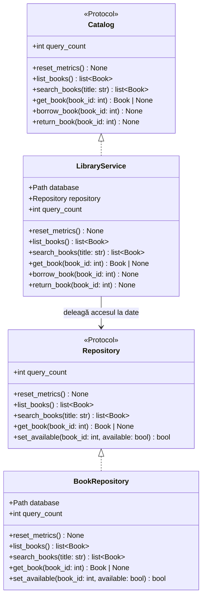

# Etapa 1 — Persoana 3: Repository și Facade

Acest document descrie implementarea aferentă **Persoanei 3** din [docs/etapa-1.md](etapa-1.md), arhitectura bazată pe pattern-urile **Repository** și **Facade**, contractul pregătit pentru integrarea cu Proxy-ul de cache (Persoana 4) și rezultatele experimentale obținute.

---

## 1. Obiectivul experimental

În Etapa 1, implementarea Persoanei 3 urmărește:
1. **Separarea responsabilităților** prin extragerea întregului cod SQL și a mapării datelor în `BookRepository` (**Repository**, Fowler — *PoEAA*) și coordonarea operațiilor prin `LibraryService` (**Facade**, GoF).
2. **Evaluarea costului de organizare a codului**: păstrând aceeași schemă SQLite, aceleași interogări cu `JOIN` și aceeași politică de conexiune per operație ca în `BaselineCatalog` și `AntiPatternJoinCatalog` (fără a introduce încă Object Pool, Singleton, cache sau indexuri suplimentare), măsurăm dacă stratul suplimentar de indirecție introduce un cost de execuție sau de memorie observabil.
3. **Pregătirea extensibilității pentru Persoana 4**: definirea unei interfețe clare `Repository` și suportarea injectării dependenței în `LibraryService`, astfel încât Proxy-ul cu cache (`CachedLibraryService`) să poată fi atașat fără modificarea serviciului.

---

## 2. Fișiere implementate

| Fișier | Rol |
|---|---|
| [`pattern/__init__.py`](../pattern/__init__.py) | Exportă `BookRepository`, `LibraryService` și protocolul `Repository`. |
| [`pattern/repository.py`](../pattern/repository.py) | Definește protocolul `Repository` și implementarea `BookRepository` (tot SQL-ul, conexiunea per operație, contorul `query_count` și maparea la `Book`). |
| [`pattern/service.py`](../pattern/service.py) | Implementează `LibraryService` (Facade), care expune contractul comun `Catalog`, coordonează operațiile și traduce rezultatele actualizărilor condiționate în `CatalogError`. |
| [`tests/test_patterns.py`](../tests/test_patterns.py) | Testează `LibraryService` prin `CatalogContract` și verifică separat `BookRepository` pe o bază SQLite temporară reală. |
| [`rezultate/pattern.csv`](../rezultate/pattern.csv) | Măsurătorile brute (100, 1.000 și 10.000 de cărți, câte 10 repetări) pentru varianta `pattern` (`LibraryService`). |

---

## 3. Arhitectura și deciziile de proiectare



### 3.1. `BookRepository` (`pattern/repository.py`)
- **Responsabilitate unică**: încapsulează accesul la baza SQLite și construcția obiectelor `Book`. Nu conține reguli de prezentare sau mesaje de eroare de domeniu.
- **Citiri cu `JOIN`**: `list_books()`, `search_books(title)` și `get_book(book_id)` folosesc metoda privată `_read()`, care execută o singură interogare cu `JOIN` între `books` și `authors`, ordonată crescător după `b.id`.
- **Actualizări condiționate atomice (`set_available`)**:
  ```sql
  UPDATE books SET available = ? WHERE id = ? AND available = ?
  ```
  Metoda returnează `True` dacă `cursor.rowcount == 1` și `False` în caz contrar (carte inexistentă sau stare incompatibilă). Nu se face un `SELECT` prealabil urmat de un `UPDATE` neprotejat, evitând atât o interogare suplimentară, cât și condițiile de cursă (race conditions) ce vor fi testate în Etapa 2.
- ** Politica de conexiuni**: deschide și închide câte o conexiune per operație (`_connection`), identic cu `BaselineCatalog`, pentru a nu distorsiona comparația din Etapa 1.

### 3.2. `LibraryService` — Rolul Facade (`pattern/service.py`)
- **Fără SQL în serviciu**: `LibraryService` nu importă `sqlite3` și nu conține interogări SQL.
- **Coordonarea regulilor de împrumut și returnare**:
  - `borrow_book(book_id)` apelează `self.repository.set_available(book_id, False)` și ridică `CatalogError` dacă actualizarea condiționată returnează `False`.
  - `return_book(book_id)` apelează `self.repository.set_available(book_id, True)` și ridică `CatalogError` dacă actualizarea condiționată returnează `False`.
- **Expunerea contorului SQL**: proprietatea `query_count` și metoda `reset_metrics()` deleagă către repository-ul activ.
- **Consemnarea costului Facade în Etapa 1**: în această etapă (unde există un singur repository și nicio politică de cache sau pool de conexiuni în varianta de bază), `LibraryService` acționează în mare parte ca un strat de delegare și traducere a erorilor de domeniu. Valoarea arhitecturală a acestui strat devine vizibilă la injectarea `CacheProxy`-ului (Persoana 4) și a politicilor de conexiuni (Etapa 2).

### 3.3. Interfața stabilită cu Persoana 4 (pentru `CacheProxy`)
Constructorul `LibraryService(database: Path, *, repository: Repository | None = None)` permite două moduri de utilizare:
1. **Standard (Benchmark / UI pentru Persoana 3)**: `LibraryService(database)` creează intern `BookRepository(database)`.
2. **Cu Proxy de cache injectat (Persoana 4)**:
   ```python
   def CachedLibraryService(database: Path) -> LibraryService:
       return LibraryService(database, repository=CachedBookRepository(BookRepository(database)))
   ```
   Orice clasă care implementează protocolul `Repository` (`list_books`, `search_books`, `get_book`, `set_available`, `query_count`, `reset_metrics`) poate fi injectată transparent în `LibraryService`.

---

## 4. Verificare și teste (`tests/test_patterns.py`)

Fișierul `tests/test_patterns.py` conține două clase de test:
1. **`TestLibraryService(CatalogContract, unittest.TestCase)`**:
   - Rulează toate testele din contractul comun `CatalogContract` peste `LibraryService`.
   - `test_constructor_does_not_execute_sql`: verifică faptul că instanțierea nu execută SQL (`query_count == 0`).
   - `test_listing_is_one_query`: verifică faptul că `list_books()` execută o singură interogare SQL (`query_count == 1`).
   - `test_service_accepts_injected_repository`: verifică injectarea unei instanțe `BookRepository` în `LibraryService` și delegarea contorului `query_count`.
2. **`TestBookRepository(unittest.TestCase)`**:
   - Testează direct `BookRepository` pe o bază SQLite temporară reală (25 de cărți).
   - Verifică `list_books()`, `search_books()`, `get_book()` și contorul SQL aferent fiecărei operații.
   - Verifică `set_available()` pentru tranziții valide (`True`), dublu împrumut (`False`), dublă returnare (`False`) și ID inexistent (`False`).

Rulare teste:
```powershell
python -m unittest tests.test_patterns -v
```

---

## 5. Rezultate experimentale (`rezultate/pattern.csv`)

Măsurătorile au fost generate cu:
```powershell
python -m benchmark.run --variants pattern --output rezultate/pattern.csv
```

### Comparație între `antipattern_join` (monolit cu JOIN) și `pattern` (`LibraryService` + `BookRepository`)

| Volum ($N$ cărți) | Scenariu | Interogări SQL | `antipattern_join` (timp mediu) | `pattern` (timp mediu) | Vârf alocări Python (`pattern`) |
|---|---|---|---|---|---|
| **100** | `list_books` | `1` | ~0.73 ms | ~0.88 ms | 22.875 KiB |
| **100** | `search_books` | `1` | ~0.78 ms | ~0.93 ms | 22.875 KiB |
| **100** | `get_book_repeated` | `100` | ~46.78 ms | ~53.18 ms | 24.211 KiB |
| **1.000** | `list_books` | `1` | ~2.31 ms | ~2.79 ms | 241.314 KiB |
| **1.000** | `search_books` | `1` | ~2.57 ms | ~2.87 ms | 241.314 KiB |
| **1.000** | `get_book_repeated` | `100` | ~53.28 ms | ~58.30 ms | 24.213 KiB |
| **10.000** | `list_books` | `1` | ~18.19 ms | ~16.83 ms | 3124.832 KiB |
| **10.000** | `search_books` | `1` | ~5.35 ms | ~5.51 ms | 243.426 KiB |
| **10.000** | `get_book_repeated` | `100` | ~55.66 ms | ~52.82 ms | 24.215 KiB |

### Constatări principale
- **Număr identic de interogări SQL**: `LibraryService` + `BookRepository` execută exact același număr de interogări ca `BaselineCatalog` și `AntiPatternJoinCatalog` (`1` la listare și căutare, `100` la citiri repetate fără cache).
- **Cost de execuție neglijabil al separării Repository + Facade**: delegarea apelurilor din `LibraryService` către `BookRepository` are un overhead Python insesizabil în raport cu timpul petrecut în I/O și SQLite, timpii și memoria alocată fiind practic echivalente cu cele ale monolitului cu `JOIN`.
